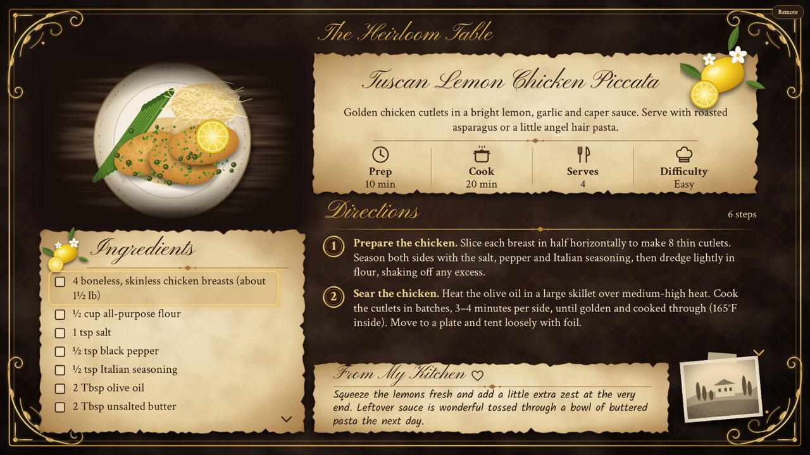

# The Heirloom Table

A family cookbook for the **Roku** (driven entirely by the remote) and a **browser clone** that looks and behaves the same.
Dark espresso backgrounds with a gold filigree frame, deckled parchment cards, script titles, and a handwritten "From My Kitchen" note on every recipe.



## Open the web clone

No build step and no server needed:

1. Open `web/index.html` in a browser by double-clicking it, or use `open web/index.html` on macOS.
2. Drive it like a Roku:

| Remote | Keyboard |
|---|---|
| D-pad | Arrow keys |
| OK | Enter |
| Back | Backspace or Esc |
| ▶︎/⏸ Play | Space |
| ◀◀ / ▶▶ | `[` / `]` |
| ✱ Options | `*` or `O` |

You can also click the **Remote** button (top right) to show the on-screen Roku-style remote, or just click or tap items: the first click focuses an item and a second click presses OK. The mouse wheel works like up and down.

Deep links (handy for screenshots): `web/index.html?screen=recipe&id=masala-chai`, `?screen=cook&id=irish-soda-bread&step=2`, `?menu=1`, `?remote=0`.

## Sideload on a Roku (developer mode)

1. **Enable developer mode.** On the Roku remote press **Home ×3, Up ×2, Right, Left, Right, Left, Right**. Write down the IP address the screen shows, accept the developer agreement, set a password, and let the device reboot.
2. **Build the package:** run `scripts/package.sh`. This writes `dist/heirloom-table-roku.zip`. Running `scripts/check.sh` also builds it.
3. **Install it.** Browse to `http://<roku-ip>` on the same network and sign in as `rokudev` with the password you set. Under *Development Application Installer*, choose `dist/heirloom-table-roku.zip` and press **Install** (or **Replace**).
4. The channel launches straight away. It also appears on the Home screen as the dev channel ("The Heirloom Table").

> Note: the channel has not been run on a physical Roku yet (none was attached to the build machine). The checks below are static and headless; see `PROGRESS.md` for what has been verified.

## Remote map (same on both)

| Key | Home | Recipe | Cook mode | Options menu |
|---|---|---|---|---|
| D-pad | move between cards and rows | up/down within a list, left/right between Ingredients and Directions | left/right (also up/down) change step | move |
| OK | open the recipe | tick an ingredient; on a step, start cook mode there | next step | choose |
| Back | exit the channel | Home | back to the recipe | up one level / close |
| Play | cook mode for the focused card | cook mode (from the focused step) | back to the recipe | |
| ◀◀ / ▶▶ | previous/next card | previous/next recipe | previous/next step | page up/down |
| ✱ | Options: reset all ticks, browse all recipes, jump to a category | Options: reset this recipe's ticks, browse, jump, home | same | close |

Ticked ingredients are remembered: in the Roku registry on the device, and in `localStorage` in the browser.

## Repository layout

```
data/recipes.json      single source of truth for recipes (edit this)
data/layout.json       shared 1920x1080 layout: Roku, web and the art generator all read it
roku/                  SceneGraph app: manifest, source/main.brs, components/*.brs|xml, fonts/, images/, data/ (generated)
web/                   browser clone: index.html, css/, js/ (one file per Roku .brs twin), recipes.js + assets/ (generated)
tools/build_data.py    validate recipes (schema, glyph coverage, food-safety sanity), write generated files and RECIPES.md
tools/make_art.py      generate every image (SVG -> WebKit via tools/render.swift -> PNG/JPG with sips)
tools/brs_lint.py      offline BrightScript lint and Roku↔web lockstep check
tools/check_assets.py  asset, size, manifest, credit and package checks
tools/web_test.js      headless behaviour test of the web clone (Node, no dependencies)
tools/screenshot.py    screenshots of the web clone (WebKit)
scripts/check.sh       run every check and build the package
scripts/package.sh     build dist/heirloom-table-roku.zip
```

How Roku and web stay in lockstep:
- Each `roku/components/X.brs` has a twin `web/js/x.js` with the same functions and logic.
- `web/js/ui.js` is a tiny SceneGraph look-alike, with `Group`, `Poster`, `Label`, `MultiStyleLabel`, `Rectangle` and `Timer` nodes.
- `tools/brs_lint.py` fails if a BrightScript function has no web twin.

## Adding a recipe

1. Add it to `data/recipes.json`. Check `RECIPES.md` first so you don't add a duplicate. Use an existing `accent.garnish`, or add a new one to `GARNISHES` in `tools/make_art.py`.
2. Add a dish illustration function to `DISHES` in `tools/make_art.py`, keyed by the recipe id.
3. Run `scripts/check.sh`. It generates the missing art, validates everything, updates `RECIPES.md` and rebuilds the package.

Requirements: macOS with the Xcode command-line tools (`swiftc`, `sips`), Python 3 and Node. No third-party packages are needed.
